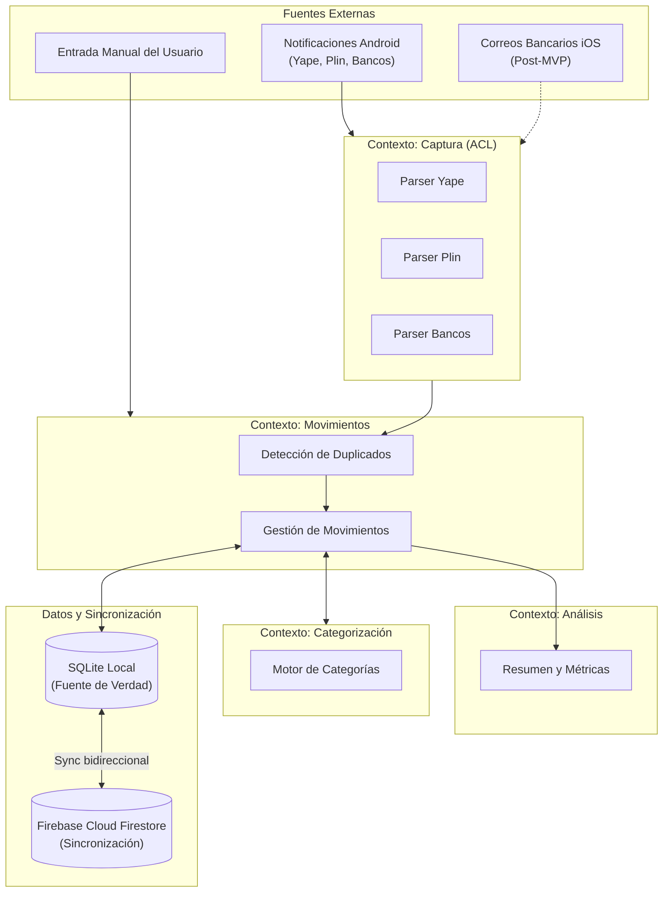
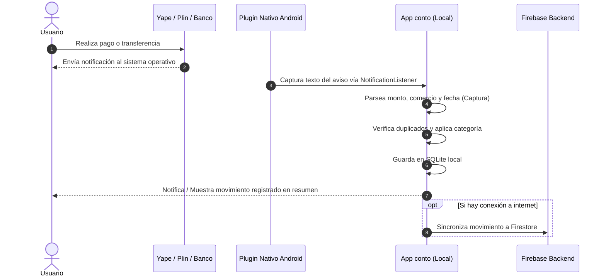

# conto

> App móvil para iOS y Android que administra tus finanzas personales y te dice con claridad **a dónde se fue tu dinero**.

**conto** centraliza y clasifica tus movimientos financieros de dos formas: **de manera manual** o **automática** capturando al instante las transacciones de billeteras digitales y bancos peruanos (**Yape, Plin, BCP, Interbank y BBVA**). Con esos registros consolidados, ofrece una vista limpia y en tiempo real de tus gastos sin tener que revisar cada app bancaria por separado ni anotar cada compra a mano.

---

## Estado del Proyecto

Actualmente el proyecto se encuentra en **fase de diseño de arquitectura y especificación técnica**.
- Toda decisión técnica relevante está documentada mediante [Registros de Decisiones de Arquitectura (ADR)](docs/adr/ADRs.md).
- El directorio [`app/`](app/) contiene el proyecto base de Flutter listo para la implementación de los contextos del dominio.

---

## Tabla de Contenidos

- [Qué es conto](#qué-es-conto)
- [Propuesta de Valor](#propuesta-de-valor)
- [Alcance del Producto](#alcance-del-producto)
- [Arquitectura y Contextos de Dominio](#arquitectura-y-contextos-de-dominio)
- [Flujo de Funcionamiento](#flujo-de-funcionamiento)
- [Integraciones](#integraciones)
- [Stack Tecnológico](#stack-tecnológico)
- [Estructura del Repositorio](#estructura-del-repositorio)
- [Privacidad y Seguridad](#privacidad-y-seguridad)
- [Guía de Inicio](#guía-de-inicio)
- [Convenciones y Desarrollo](#convenciones-y-desarrollo)

---

## Qué es conto

En el Perú, el día a día financiero está fragmentado entre billeteras digitales (Yape, Plin) y múltiples entidades bancarias. La mayoría de personas pierde el rastro de sus gastos pequeños ("gastos hormiga") porque anotarlos uno a uno exige una disciplina tediosa.

**conto** resuelve este problema capturando el gasto en el momento exacto en que ocurre:
1. En **Android**, escucha las notificaciones generadas por Yape, Plin y las apps bancarias mediante un servicio nativo seguro.
2. Extrae monto, comercio o destinatario y fecha/hora.
3. Lo clasifica en una categoría y lo refleja al instante en el balance mensual del usuario.
4. Funciona **sin conexión** gracias a una arquitectura *local-first*, sincronizando con la nube cuando haya red disponible.

---

## Propuesta de Valor

- **Cero fricción:** Registra tus gastos sin que tengas que acordarte de abrir la app cada vez que compras algo.
- **Unificación real:** Un único panel para tus movimientos de Yape, Plin, BCP, BBVA e Interbank.
- **Local-first (sin internet):** La app funciona al 100% sin conexión; tus transacciones se guardan en el dispositivo y se sincronizan al volver la red.
- **Detección de duplicados:** Si una transacción genera múltiples avisos (ej. notificación y correo), conto la identifica para no duplicarla.
- **Privacidad ante todo:** Solo se procesan las notificaciones pertinentes de entidades autorizadas por el usuario. conto nunca solicita acceso para mover dinero ni claves de acceso a los bancos.

---

## Alcance del Producto

Definido formalmente en el [ADR-001](docs/adr/0001-alcance-mvp.md) y [ADR-006](docs/adr/0006-captura-automatica.md):

| Dentro del MVP | Posterior al MVP | Fuera de Alcance |
|---|---|---|
| **Registro manual** de gastos e ingresos (iOS y Android). | **Registro automático en iOS** mediante lectura de correos de aviso bancario (Gmail / Outlook vía OAuth en Cloud Functions). | **Lectura de SMS** (restringido por políticas de Google Play y riesgo de seguridad). |
| **Registro automático en Android** vía `NotificationListenerService` para Yape, Plin, BCP, Interbank y BBVA. | Presupuestos dinámicos y alertas personalizadas de sobregasto. | **Conexión directa por Open Banking** (no disponible comercialmente en Perú). |
| **Categorización** de movimientos con edición manual. | Motor de aprendizaje de categorías a partir de correcciones del usuario. | **Operaciones transaccionales:** conto solo lee y analiza, no transfiere ni mueve dinero. |
| **Vista de resumen analítico:** gráficos y totales por categoría y período. | Exportación de reportes (PDF / Excel). | Conexión con entidades no bancarias o no soportadas en la fase inicial. |
| **Cuenta y sincronización:** autenticación con correo, Google y Apple ([ADR-005](docs/adr/0005-autenticacion.md)). | Autenticación biométrica local (FaceID / Fingerprint) como capa de conveniencia. | |
| **Persistencia local-first:** SQLite en el teléfono como fuente de verdad inmediata ([ADR-004](docs/adr/0004-local-primero.md)). | | |

---

## Arquitectura y Contextos de Dominio

La solución utiliza Flutter con un enfoque de **Domain-Driven Design (DDD) ligero** ([ADR-002](docs/adr/0002-flutter-y-ddd-ligero.md)), dividiendo el sistema en contextos delimitados y desacoplados:



### Contextos Delimitados:
1. **Captura:** Actúa como *Capa Anticorrupción* (ACL). Recibe los eventos externos en bruto (payloads de notificaciones o correos), los valida, descarta información superflua y los transforma al modelo interno estándar.
2. **Movimientos:** Núcleo transaccional del sistema. Modela ingresos y egresos, garantiza la unicidad y detecta duplicaciones entre distintas fuentes de captura.
3. **Categorización:** Asigna etiquetas y categorías a cada movimiento (Alimentación, Transporte, Servicios, etc.) y gestiona las personalizaciones del usuario.
4. **Análisis:** Calcula agregados, métricas de gasto periódico y distribuciones porcentuales para las pantallas de resumen.
5. **Cuenta y Sincronización:** Administra la sesión del usuario, políticas de seguridad y la replicación bidireccional entre SQLite y Cloud Firestore.

---

## Flujo de Funcionamiento

### Para el Usuario


---

## Integraciones

- **Billeteras y Bancos (vía Android):**
  - **Yape:** Captura de pagos a contactos y comercios (QR).
  - **Plin:** Captura de transferencias y pagos.
  - **Apps Bancarias:** BCP, Interbank y BBVA.
- **Firebase Platform ([ADR-003](docs/adr/0003-firebase-como-backend.md)):**
  - **Firebase Authentication:** Gestión de identidades (Correo/Password, Google Sign-In, Sign in with Apple) ([ADR-005](docs/adr/0005-autenticacion.md)).
  - **Cloud Firestore:** Almacenamiento seguro por usuario en la nube con reglas de acceso estrictas.
  - **Cloud Functions:** Procesamiento asíncrono y soporte para lectura de correos en iOS (post-MVP).

---

## Stack Tecnológico

| Capa / Componente | Tecnología | Justificación |
|---|---|---|
| **Frontend Móvil** | [Flutter](https://flutter.dev/) (Dart) | Una sola base de código para iOS y Android ([ADR-002](docs/adr/0002-flutter-y-ddd-ligero.md)). |
| **Captura Nativa** | Kotlin (`NotificationListenerService`) | Acceso eficiente y en segundo plano a notificaciones del sistema en Android ([ADR-006](docs/adr/0006-captura-automatica.md)). |
| **Persistencia Local** | SQLite (Drift / sqflite) | Enfoque *local-first*: velocidad de interfaz y tolerancia total a desconexión ([ADR-004](docs/adr/0004-local-primero.md)). |
| **Backend & Cloud** | [Firebase](https://firebase.google.com/) | Auth, Firestore y Functions con SDK maduro para Flutter y rápida velocidad de entrega ([ADR-003](docs/adr/0003-firebase-como-backend.md)). |

---

## Estructura del Repositorio

```text
conto/
├── app/                  # Proyecto móvil en Flutter
│   ├── android/          # Configuración nativa Android y servicio de notificaciones
│   ├── ios/              # Configuración nativa iOS
│   ├── lib/              # Código fuente Dart (organizado por contextos DDD)
│   ├── test/             # Pruebas unitarias y de integración
│   └── pubspec.yaml      # Dependencias y configuración de Flutter
├── docs/                 # Documentación del proyecto
│   └── adr/              # Registros de Decisiones de Arquitectura (ADR)
│       ├── 0000-plantilla.md
│       ├── 0001-alcance-mvp.md
│       ├── 0002-flutter-y-ddd-ligero.md
│       ├── 0003-firebase-como-backend.md
│       ├── 0004-local-primero.md
│       ├── 0005-autenticacion.md
│       ├── 0006-captura-automatica.md
│       ├── 0007-convencion-de-commits.md
│       └── ADRs.md       # Índice consolidado de ADRs
└── README.md             # Esta documentación
```

---

## Privacidad y Seguridad

Los datos financieros son de naturaleza altamente sensible. conto se rige por los siguientes principios:

1. **Cumplimiento Normativo:** Alineado con la **Ley N° 29733** (Ley de Protección de Datos Personales de Perú).
2. **Sin Credenciales Financieras:** conto **nunca** solicita contraseñas bancarias, tokens ni números completos de tarjetas.
3. **Mínimo Privilegio:** En Android se solicita únicamente el permiso de acceso a notificaciones, filtrando exclusivamente los identificadores de paquetes de las apps autorizadas por el usuario.
4. **Reglas de Seguridad Estrictas:** En Firestore, cada usuario tiene acceso exclusivo y autenticado a sus propios registros (`request.auth.uid == resource.data.userId`).

---

## Guía de Inicio

### Requisitos Previos

- [Flutter SDK](https://docs.flutter.dev/get-started/install) (`^3.13.7` o superior).
- [Android Studio](https://developer.android.com/studio) con Android SDK y emulador o dispositivo físico configurado.
- [Xcode](https://developer.apple.com/xcode/) (requerido para compilar y probar en iOS o macOS).
- [Git](https://git-scm.com/).

### Instalación y Ejecución

1. **Clonar el repositorio:**
   ```bash
   git clone https://github.com/tu-usuario/conto.git
   cd conto
   ```

2. **Instalar dependencias de Flutter:**
   ```bash
   cd app
   flutter pub get
   ```

3. **Verificar el entorno:**
   ```bash
   flutter doctor
   ```

4. **Ejecutar la aplicación en modo desarrollo:**
   ```bash
   flutter run
   ```

5. **Ejecutar los tests:**
   ```bash
   flutter test
   ```

---

## Convenciones y Desarrollo

### Decisiones de Arquitectura (ADR)
Cualquier cambio estructural o de diseño debe documentarse como un nuevo ADR en [`docs/adr/`](docs/adr/ADRs.md) siguiendo la plantilla oficial ([`0000-plantilla.md`](docs/adr/0000-plantilla.md)). Nunca se sobreescribe un ADR antiguo; se crea uno nuevo que lo referencie y sustituya.

### Convención de Commits
Se utiliza **Conventional Commits 1.0** ([ADR-007](docs/adr/0007-convencion-de-commits.md)):

```text
<tipo>(<alcance>): <descripción en minúsculas, imperativo, sin punto final>
```

- **Tipos permitidos:** `feat`, `fix`, `docs`, `refactor`, `test`, `chore`, `build`, `ci`, `perf`, `style`.
- **Alcances permitidos:** `captura`, `movimientos`, `categorizacion`, `analisis`, `cuenta`, `android`, `ios`, `adr`, `docs`.
- **Idioma:** Descripción en español.
- **Ejemplos:**
  - `feat(captura): parsea notificaciones de yape`
  - `fix(movimientos): evita duplicados en transferencias plin`
  - `docs(adr): adopta formato propio de adrs`
